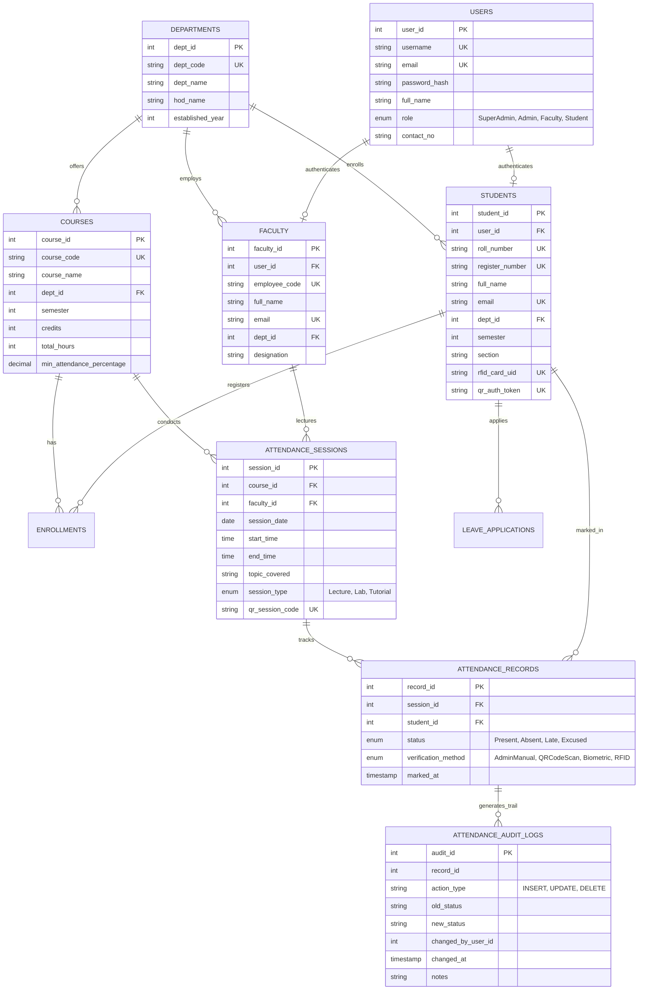

# Entity-Relationship (ER) Diagram & Relational Schema
## Smart Attendance Management System (SAMS) - DBMS Mini Project

---

### 1. Conceptual Entity-Relationship (ER) Diagram

---

### 2. Relational Schema Representation
* **Departments** (**dept_id**, dept_code, dept_name, hod_name, established_year)
* **Users** (**user_id**, username, email, password_hash, full_name, role, contact_no, is_active, created_at)
* **Faculty** (**faculty_id**, *user_id*, employee_code, full_name, email, phone, *dept_id*, designation, joining_date)
* **Courses** (**course_id**, course_code, course_name, *dept_id*, semester, credits, total_hours, min_attendance_percentage)
* **Students** (**student_id**, *user_id*, roll_number, register_number, full_name, email, phone, *dept_id*, semester, section, admission_year, rfid_card_uid, qr_auth_token)
* **Enrollments** (**enrollment_id**, *student_id*, *course_id*, academic_year, enrollment_date)
* **Attendance_Sessions** (**session_id**, *course_id*, *faculty_id*, session_date, start_time, end_time, topic_covered, session_type, classroom, qr_session_code, status)
* **Attendance_Records** (**record_id**, *session_id*, *student_id*, status, verification_method, marked_at, *marked_by_user_id*, remarks)
* **Attendance_Audit_Logs** (**audit_id**, record_id, session_id, student_id, action_type, old_status, new_status, changed_by_user_id, changed_at, notes)

---

### 3. Normalization Verification (1NF to 3NF)

1. **First Normal Form (1NF)**:
   - Each column contains atomic (indivisible) values. No multi-valued attributes or repeating groups (e.g., student phone numbers and attendance instances are stored in discrete records, not comma-separated lists).
   - Every table has a clearly defined Primary Key.

2. **Second Normal Form (2NF)**:
   - Meets all criteria of 1NF.
   - No partial functional dependency exists: All non-key attributes are fully functionally dependent on the entire Primary Key. In junction tables (like `enrollments` or `attendance_records`), composite uniqueness is maintained without partial key dependencies.

3. **Third Normal Form (3NF)**:
   - Meets all criteria of 2NF.
   - No transitive functional dependency exists: Non-prime attributes depend ONLY on the primary key ($X \rightarrow Y$ where $X$ is a superkey, or $Y$ is a prime attribute). Department information is referenced via `dept_id` foreign key rather than repeating department names or HOD names inside the `students` or `courses` tables.
